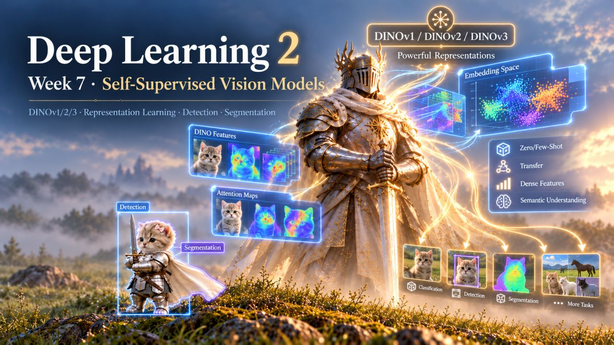

# Self-Supervised Vision Models

Lecturer and seminarian: [Alexander Oganov](https://www.hse.ru/org/persons/956617478/)

Recordings (in Russian): [lecture](https://youtu.be/jGMhAkkK-pw), [seminar](https://youtu.be/r_yafKPwIfg).

## Annotation

This week, we'll explore the DINOv1/2/3 family of models. We'll cover the core ideas, the improvements from one version to the next, and how these models learn their representations. Thanks to strong representations, many computer vision tasks can be solved in a zero- or few-shot setting. We'll also look at how DINO features can be used for detection and segmentation. In the hands-on part, we'll inspect the latent space of the features and apply them to concrete downstream tasks.

  

